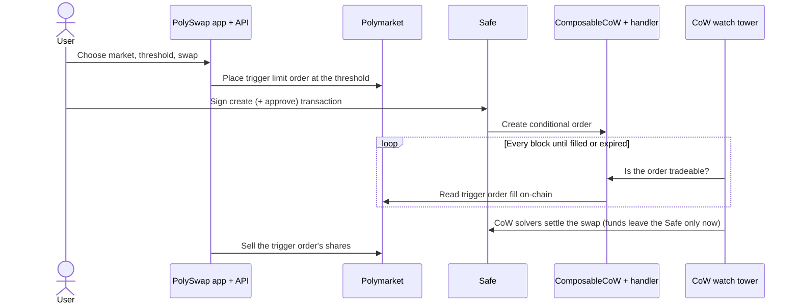

<div align="center">


<h1>PolySwap</h1>

<p><strong>Token swaps on Polygon that execute only when a Polymarket outcome reaches the odds you choose.</strong></p>

<p>
  
  <a href="https://github.com/PolyswapLabs/polyswap-dapp/stargazers"></a>
  <a href="https://github.com/PolyswapLabs/polyswap-dapp/commits"></a>
</p>

<p>
  
  
  
  
  
</p>

<p>
  <a href="https://polyswap.lucasl.dev"><b>Website</b></a> ·
  <a href="public/polyswap-ads.mp4"><b>Watch the video</b></a> ·
  <a href="#how-it-works"><b>How it works</b></a> ·
  <a href="#getting-started"><b>Getting started</b></a>
</p>

</div>

> _"Swap 1,000 USDC for WETH if 'Will the Fed cut rates in December?' trades at 70% YES or higher before Friday."_

Funds stay in your Safe until the condition is met. If it never is, the order expires and nothing moves.

## How it works

1. **Create.** You pick a market, an outcome, a probability threshold, the swap and an expiry date. The backend places a small Polymarket limit order that buys shares of that outcome at your threshold price. This is the _trigger order_ (called a `sentinel` in the code). Swaps with the same market, outcome, price and expiry share one trigger order.
2. **Sign.** Your Safe signs one transaction that creates a CoW Protocol conditional order on `ComposableCoW`. If needed, it also approves the sell token and installs CoW's `ExtensibleFallbackHandler`.
3. **Wait.** On every block, the PolySwap handler (the contract that decides when the conditional order is valid) reads the trigger order's fill on Polymarket's exchange contract. Once it has filled, the market has traded at your price and the condition is met.
4. **Swap.** CoW's watch tower then posts the order to the CoW order book, and solvers settle it in a batch auction.
5. **Clean up.** The backend sells the shares the trigger order bought, so it never holds market risk.

You can cancel a live order at any time. The Safe calls `ComposableCoW.remove()`, and the order can no longer trade.



## Architecture

| Part         | What it does                                                                                                                                                                                                                 |
| ------------ | ---------------------------------------------------------------------------------------------------------------------------------------------------------------------------------------------------------------------------- |
| **Web app**  | Next.js 15 / React 19. Market browser, order creation, dashboard. Wallets: Safe App and WalletConnect (Safe accounts only).                                                                                                  |
| **API**      | Next.js routes under `/api`. Markets, order creation (places the trigger order, returns the Safe transactions), order lookup and cancellation.                                                                               |
| **Listener** | Long-running Node process. Indexes order creation, trade and invalidation events, checks live orders every minute (fillable, expired, removed), sells the shares bought by trigger orders and syncs markets from Polymarket. |
| **Database** | PostgreSQL ([Nile](https://www.thenile.dev/)) through Prisma: markets, orders, trigger orders (`polymarket_sentinels`), sold positions, listener cursor.                                                                     |

```
src/
  app/          Next.js pages and API routes
  components/   UI
  hooks/        React hooks (orders, markets, Safe flow)
  client/       Browser-only code (API client, Safe, wagmi)
  server/       Server-only helpers for API routes (errors, Swagger, PostHog)
  backend/      Listener, database repositories, Polymarket and RPC clients
  shared/       Code used by both the browser and the backend
prisma/         Schema and migrations
script/         One-off operational scripts
test/           Unit and regression tests
```

## Getting started

Requirements: Node 24+, pnpm 11, a PostgreSQL database and a Polygon RPC.

```bash
pnpm install            # also runs `prisma generate`
cp .env.sample .env     # then fill it in (see below)
pnpm db:migrate         # apply migrations

pnpm start:listener     # terminal 1: listener and background jobs
pnpm dev                # terminal 2: web app on http://localhost:3000
```

The API is documented in Swagger UI at `http://localhost:3000/api-docs` (OpenAPI JSON at `/api/swagger`).

### Environment

`.env.sample` lists every variable with a comment. The ones you must set:

| Group      | Variables                                                                        |
| ---------- | -------------------------------------------------------------------------------- |
| Database   | `DATABASE_URL`, or `DB_HOST` / `DB_PORT` / `DB_NAME` / `DB_USER` / `DB_PASSWORD` |
| RPC        | `RPC_URL`, `WSS_RPC_URL` (listener), `NEXT_PUBLIC_RPC_URL` (browser)             |
| Polymarket | `PK`, `CLOB_API_KEY`, `CLOB_SECRET`, `CLOB_PASS_PHRASE`                          |
| Wallets    | `NEXT_PUBLIC_WC_PROJECT_ID` (WalletConnect)                                      |

Generate the Polymarket API credentials from `PK` with `pnpm get-polymarket-creds`. The contract addresses in `.env.sample` are the Polygon mainnet deployments.

Sentry and PostHog only run when `ENVIRONMENT` is `prod` or `production`. `ORDER_CREATION_DISABLED` and `DAPP_MAINTENANCE` are the operational kill switches.

## Scripts

| Command                                                   | Purpose                                                         |
| --------------------------------------------------------- | --------------------------------------------------------------- |
| `pnpm dev` / `build` / `start`                            | Web app                                                         |
| `pnpm start:listener`                                     | Listener with every job (events, order health, seller, markets) |
| `pnpm start:listener-only`                                | Event indexing only                                             |
| `pnpm start:market-sync`                                  | Market sync only                                                |
| `pnpm markets:sync`                                       | Run one market sync, then exit                                  |
| `pnpm test`                                               | Tests (no database or network needed)                           |
| `pnpm typecheck` / `lint` / `format:check`                | Static checks                                                   |
| `pnpm db:migrate` / `db:status` / `db:diff` / `db:studio` | Prisma migrations and inspection                                |

Operational scripts (they act on the operator wallet, so read them before running):

| Command                           | Purpose                                            |
| --------------------------------- | -------------------------------------------------- |
| `pnpm get-polymarket-creds`       | Derive Polymarket API credentials from `PK`        |
| `pnpm setup-polymarket-approvals` | Grant the approvals Polymarket trading needs       |
| `pnpm register-cow-appdata`       | Register the CoW app-data document                 |
| `pnpm check-polymarket-orders`    | Print open orders, positions and on-chain balances |
| `pnpm cancel-polymarket-orders`   | Cancel every open Polymarket order                 |
| `pnpm sell-polymarket-positions`  | Sell every open Polymarket position                |
| `pnpm pusd`                       | Wrap or unwrap pUSD                                |

## Deployment

The `Dockerfile` builds the listener image. It contains only `src/backend`, `src/shared` and the ABIs, and runs the listener with every job, like `pnpm start:listener`. The web app is a standard Next.js build. Run `pnpm db:migrate` before deploying a release that adds migrations.

## Authors

| [<br><sub>Lucas Leclerc</sub>](https://github.com/Intermarch3) | [<br><sub>Baptiste Florentin</sub>](https://github.com/Pybast) |
| :---------------------------------------------------------------------------------------------------------------------------: | :----------------------------------------------------------------------------------------------------------------------: |
