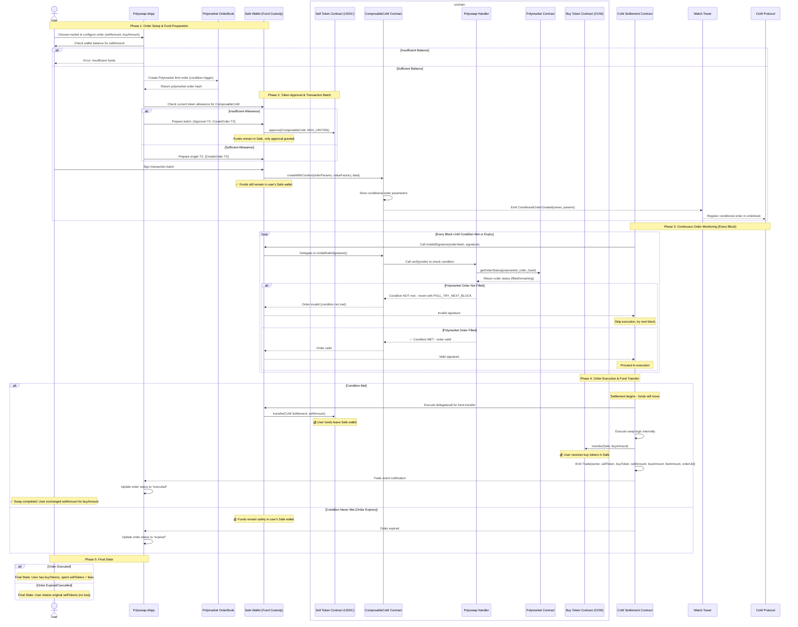

# 🔄 PolySwap

**Automated DeFi swaps triggered by prediction market outcomes on Polygon**

PolySwap is a decentralized application that enables users to create conditional swap orders that execute automatically when specific prediction market outcomes are resolved. Built on top of CoW Swap's conditional order framework, PolySwap bridges the gap between prediction markets and DeFi trading.

## 🎯 What Is PolySwap?

PolySwap allows you to:

- **🎲 Create Conditional Orders**: Set up token swaps that only execute when your predicted market outcome occurs
- **📊 Browse Markets**: Explore Polymarket prediction markets directly in the interface
- **⚡ Automatic Execution**: Orders execute automatically when market conditions resolve in your favor
- **🔒 Trustless**: Built on CoW Swap's proven conditional order infrastructure
- **💸 Gas Efficient**: Leverages batch auctions and off-chain order matching
- **🔐 Safe Wallet Integration**: Secure multi-signature wallet support for institutional users

### Example Use Case

> _"I believe if Trump wins the 2024 election, crypto market will go up. If my Polymarket bet gets filled, I want to automatically swap 1000 USDC for ETH at current market rates."_

With PolySwap, you can create this conditional order that will only execute if the condition is met, eliminating the need to manually monitor the prediction market outcome and execute the trade yourself.

> 🎥 **[Watch the PolySwap demo video](./public/polyswap_demo.mp4)**

## 🏗️ Architecture Overview

PolySwap consists of integrated frontend and backend components:

### 🖥️ Frontend (Next.js)

- **Modern React Interface**: Built with Next.js 15 and React 19
- **Market Browser**: Search and explore Polymarket prediction markets
- **Order Creation Flow**: Intuitive interface for setting up conditional swaps with Polymarket integration
- **Order Management**: Track and manage your active conditional orders
- **Safe Wallet Integration**: Gnosis Safe support with WalletConnect for secure transactions
- **Real-time Updates**: Live order status and market data synchronization

### ⚙️ Backend (Node.js + TypeScript)

- **Next.js API Routes**: Integrated API serving market data and order information
- **Blockchain Listener**: Monitors Polygon for PolySwap order events and trade executions
- **PostgreSQL Database**: Stores market data, order history, and order UIDs
- **Real-time Processing**: Indexes and processes orders as they're created
- **Order UID Calculation**: Automatic calculation and storage of CoW Protocol order UIDs

📚 **[View Detailed Backend Documentation with API endpoints →](./Backend.md)**

## 🚀 Quick Start

### Prerequisites

- Node.js 20+ and pnpm
- A PostgreSQL database (the project uses [Nile](https://www.thenile.dev/) — `prisma.config.ts` builds the URL from `DB_HOST/DB_USER/DB_PASSWORD/DB_NAME`, or set `DATABASE_URL` directly)

### Installation

```bash
# Install dependencies (also runs `prisma generate` via postinstall)
pnpm install

# Set up environment variables
cp .env.sample .env
# Edit .env with your DB credentials, RPC URL, Polymarket creds, etc.

# Apply schema migrations
pnpm db:migrate
```

### Running the Application

1. **Start the backend services** (blockchain listener + market updater + position seller):

   ```bash
   pnpm start:listener
   ```

2. **Start the frontend** (in another terminal):

   ```bash
   pnpm dev
   ```

3. **Access the application**:
   - Frontend: `http://localhost:3000`
   - API docs (Swagger UI): `http://localhost:3000/api-docs`

## 🔧 Available Scripts

### Frontend Development

```bash
pnpm dev          # Start Next.js development server (port 3000)
pnpm build        # Build production frontend
pnpm start        # Start production frontend
pnpm lint         # Run ESLint
```

### Backend Services

```bash
pnpm start:listener               # Start blockchain listener + market updater
pnpm start:listener-only          # Start only blockchain listener
pnpm start:market-updater         # Start only market updater (via listener)
pnpm start:market-updater-standalone # Start standalone market updater
```

### Market Data Management

```bash
pnpm saveMarkets   # Fetch markets from Polymarket API to data.json
pnpm db:import     # Import markets from data.json to database
```

### Market Recommendations

`GET /api/markets/recommended` reads the existing market index and enriches up to
300 candidates with up to three concurrent Gamma requests of 100 IDs each.
Gamma's ID filter has a 100-item maximum per request.
Prices and daily metrics are cached only in server memory for two minutes; no
database writes, migrations, or new refresh jobs are needed.

Browse defaults to 10–90% YES odds, at least $10,000 lifetime volume, $5,000
liquidity, $1,000 daily volume, a spread of at most 5 percentage points, and more
than 48 hours remaining. Quality scoring combines daily activity, liquidity and
spread, uncertainty, category/tag relevance, and time remaining. The database
shortlist uses the existing interest ranking in All and each selected category. Sibling markets
are deferred across 20-result blocks. `total` counts eligible recommendations in
the shortlist, not the whole catalogue; `truncated` identifies a capped shortlist.

The browse page keeps category selection and pagination, with fixed 10–90% YES
odds. Old odds parameters in page URLs do not override that range. The API still
accepts `category`, `oddsMin`, `oddsMax`, `limit`, and `offset`.
Search uses `/api/markets/search` independently of recommendation thresholds.
The browser still loads charts, limited to four simultaneous history requests.

When any Gamma batch returns HTTP 429, the endpoint returns `source: "database"`
and the existing database shortlist, filtered and ordered on the backend. The
browser loads CLOB prices as it did for the previous list and labels stored
volume as total volume. No odds, daily-volume, or spread filters are applied in
this fallback because those values are not stored in the database. Gamma calls
pause across all categories for at least two minutes, respecting a longer
`Retry-After` header. After the cooldown, the next request rebuilds recommendations.
Other Gamma failures still return an error rather than silently changing the feed.
The browser's public-data availability check also permits HTTP 429 so it cannot
hide the database fallback behind the unavailable dialog.

Run the focused regression tests without database or network access:

```bash
node --import tsx --test tests/*.test.ts
```

### Database Management

```bash
pnpm db:migrate   # Apply pending Prisma migrations (prisma migrate deploy)
pnpm db:status    # Inspect migration state on the configured DB
pnpm db:diff      # Diff the live DB against prisma/schema.prisma (script form)
pnpm db:generate  # Regenerate the Prisma client (also runs on postinstall)
pnpm db:studio    # Open Prisma Studio
pnpm db:import    # Import markets from data.json into the DB
```

### Utility Scripts

```bash
pnpm get-polymarket-creds         # Generate Polymarket API credentials
pnpm cancel-polymarket-orders     # Cancel all open Polymarket orders
pnpm sell-polymarket-positions    # Sell all open Polymarket positions
pnpm check-polymarket-orders      # Print orders, positions and on-chain CTF balances
pnpm pusd                         # Wrap / unwrap pUSD (Polymarket's USDC bridge)
```

### Code Quality

```bash
pnpm format        # Run Prettier across the repo
pnpm format:check  # Verify formatting without writing
pnpm lint          # Run ESLint
```

## 🔄 Automatic Market Updates

PolySwap includes an automatic market update service that keeps your database synchronized with the latest Polymarket data.

### Configuration

Set the update interval in your `.env` file:

```bash
MARKET_UPDATE_INTERVAL_MINUTES=5  # Update every 5 minutes (default)
AUTO_REMOVE_CLOSED_MARKETS=true   # Remove closed markets automatically
```

## 🛡️ Automatic Position Selling

To prevent the system from holding risk after Polymarket BUY orders are executed, PolySwap includes an automatic position selling service. When a user creates a PolySwap limit order, the backend creates a corresponding Polymarket BUY order. Once this order is filled, the system holds a position that could gain or lose value. The position seller service automatically sells these positions to maintain solvency.

### How It Works

1. The service runs every X minutes (default: 5 minutes)
2. It fetches all current positions from the Polymarket API
3. For each position found, it creates a SELL order at 95% of current price for faster execution
4. All sales are logged to the database for auditing

### Configuration

Set the sell interval in your `.env` file:

```bash
POSITION_SELL_INTERVAL_MINUTES=5  # Check and sell positions every 5 minutes (default)
```

## ⚙️ Environment Configuration

Key environment variables (see `.env.sample`):

### Database

```bash
DB_HOST=localhost
DB_PORT=5432
DB_NAME=polyswap
DB_USER=postgres
DB_PASSWORD=your_password
```

### Polymarket API

```bash
CLOB_API_KEY=your_api_key
CLOB_SECRET=your_secret
CLOB_PASS_PHRASE=your_passphrase
```

> **ℹ️ Info:** You can generate these Polymarket API credentials with the script:
>
> ```
> pnpm get-polymarket-creds
> ```

### Blockchain Configuration

```bash
RPC_URL=https://polygon-rpc.com/
STARTING_BLOCK=76437998
COMPOSABLE_COW=0xfdaFc9d1902f4e0b84f65F49f244b32b31013b74
NEXT_PUBLIC_POLYSWAP_HANDLER=0x65a5B712F34d8219A4c70451353D2F6A80e6703c
EXTENSIBLE_FALLBACK_HANDLER=0x2f55e8b20D0B9FEFA187AA7d00B6Cbe563605bF5
```

### Backend Services Configuration

```bash
MARKET_UPDATE_INTERVAL_MINUTES=60    # Market data sync interval (default: 60)
POSITION_SELL_INTERVAL_MINUTES=5     # Position auto-sell check interval (default: 5)
AUTO_REMOVE_CLOSED_MARKETS=true      # Clean up closed markets automatically
```

## 💰 Fund Flow Architecture

The following diagram illustrates how funds move through the PolySwap system during a conditional order lifecycle:



> **Note:** If the diagram does not display correctly, here is the diagram as a PNG:  
> [polyswap_mermaid.png](./public/polyswap_mermaid.png)

## 🔐 Safe Wallet Integration

PolySwap is designed to work exclusively with Gnosis Safe wallets for enhanced security:

### Supported Connection Methods

- **Safe Apps (TODO)**: Run PolySwap directly inside the Safe interface
- **WalletConnect**: Connect external Safe wallets via WalletConnect protocol

## 🧑‍💻 Authors

| [<br><sub>Lucas Leclerc</sub>](https://github.com/Intermarch3) | [<br><sub>Baptiste Florentin</sub>](https://github.com/Pybast) |
| :---------------------------------------------------------------------------------------------------------------------------: | :----------------------------------------------------------------------------------------------------------------------: |
